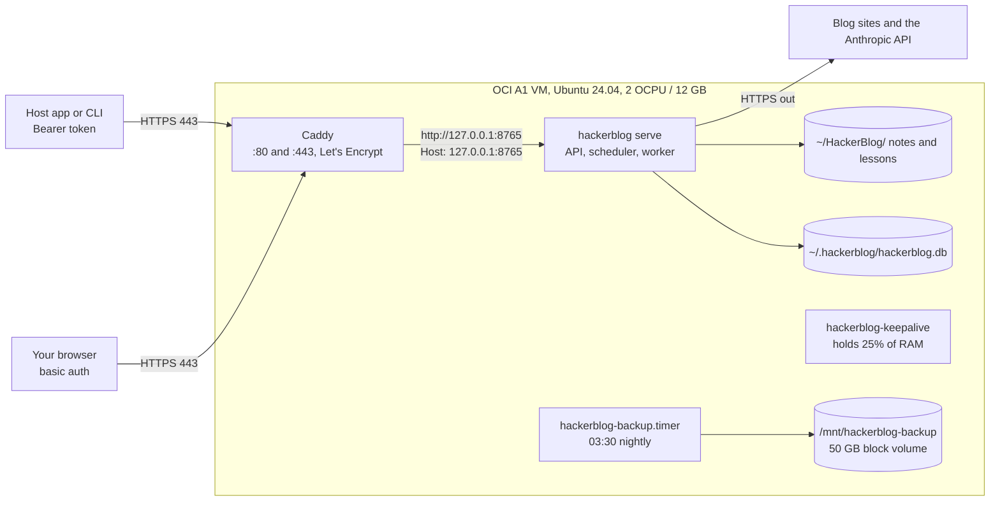

# Run HackerBlog 24/7 on an Oracle Cloud Always Free VM

This guide puts HackerBlog on one Oracle Cloud Infrastructure (OCI) Always Free Arm VM. The VM runs the API, the scheduler and the worker all the time. Caddy serves it over HTTPS, and you pay nothing as long as you stay inside the limits in the "Stays free if" checklist.

Everything Oracle-specific below was checked against Oracle's own pages on 2026-11-10. Each fact has its source. Oracle changes these pages: the A1 allowance used to be 4 OCPUs and 24 GB and is now 2 OCPUs and 12 GB. Check the sources again before you sign up.

## Contents

1. [What you get for free](#1-what-you-get-for-free)
2. [How the deployment looks](#2-how-the-deployment-looks)
3. [Before you start](#3-before-you-start)
4. [Step by step](#4-step-by-step)
5. [Stays free if](#5-stays-free-if)
6. [Costs and risks](#6-costs-and-risks)
7. [Day-to-day operations](#7-day-to-day-operations)
8. [Troubleshooting](#8-troubleshooting)
9. [What the deploy files do](#9-what-the-deploy-files-do)
10. [What was and was not tested](#10-what-was-and-was-not-tested)
11. [Sources](#11-sources)

## 1. What you get for free

| Resource | Always Free amount | Source |
|---|---|---|
| Arm compute (VM.Standard.A1.Flex) | The first 1,500 OCPU hours and 9,000 GB hours each month. For Always Free tenancies that equals 2 OCPUs and 12 GB of memory, as one VM or as two VMs of 1 OCPU each. | [S1] |
| AMD compute (VM.Standard.E2.1.Micro) | Up to 2 VMs, each 1/8 OCPU and 1 GB of memory, 50 Mbps internet bandwidth. Too small for HackerBlog. | [S1] |
| Block storage | 200 GB in total for boot volumes and block volumes together, plus 5 volume backups. A boot volume is at least 47 GB, and 50 GB by default. | [S1] |
| Object Storage | 20 GB in total across the Standard, Infrequent Access and Archive tiers, and 50,000 API requests a month, once the trial has ended. A paid or trial account instead gets 10 GB in each tier. | [S1] |
| Outbound data transfer | 10 TB a month. | [S1] |
| Public IPv4 | Each instance in a public subnet gets an ephemeral public IP by default. It stays assigned when you stop the instance and is deleted only when you terminate the instance. Oracle's Always Free page does not list a separate charge for it. | [S1], [S4] |
| Networking | Up to 2 VCNs on a free tenancy. Outbound TCP port 25 (e-mail) is blocked by default. | [S1] |
| Monitoring and notifications | 500 million Monitoring ingestion data points; 1 million HTTPS and 1,000 e-mail OCI notifications a month. | [S1] |

**Images.** The Always Free A1 shape takes the images labelled "Always Free-eligible": Oracle Linux, Oracle Linux Cloud Developer (needs at least 8 GB of memory) and Ubuntu [S1]. This guide uses **Canonical Ubuntu 24.04**, whose `python3` is 3.12, the version HackerBlog needs.

**Regions and the home region.** Always Free resources exist only in your tenancy's **home region**, the region you pick at sign-up. You cannot change it later [S1], [S5]. A block volume made outside the home region is billed at the normal rate [S1]. A1 instances can be created in any availability domain, except in South Korea North (Chuncheon) [S1]. Always Free is offered in every region where commercial OCI runs [S3].

**Card verification at sign-up.** Oracle asks for a credit card, or a debit card that works like one, to verify who you are. PIN debit cards and virtual, single-use or prepaid cards are refused. Oracle may place a temporary authorization hold on the card, which your bank drops within 3 to 5 days, and you are not charged [S3]. Sign-up also starts a 30-day Free Trial with US$300 of credit [S3].

## 2. How the deployment looks



- `hackerblog serve` listens on 127.0.0.1:8765 only. Caddy is the only thing listening on public ports 80 and 443.
- The browser paths `/`, `/files` and `/files/*`, which include the library page `/files/index.html`, need a basic-auth login in Caddy. Caddy then removes that `Authorization` header before it forwards the request.
- The `/v1/...` API is forwarded unchanged and still needs the HackerBlog bearer token (`HACKERBLOG_API_TOKEN` in `secrets.env`). `/v1/health` stays open without a token, as it does on a laptop.
- Caddy sets the upstream `Host` header to `127.0.0.1:8765`. HackerBlog's Trusted Host check accepts only loopback names when it is bound to loopback, so no app change is needed.
- The OCI security list and the VM's iptables rules allow only TCP 22, 80 and 443 in. SSH takes keys only.

## 3. Before you start

You need:

- A credit card for verification (see section 1).
- An SSH key pair on your laptop. If `~/.ssh/id_ed25519.pub` does not exist yet, run `ssh-keygen -t ed25519`.
- The HackerBlog git repository URL. A private GitHub repository works: setup creates a deploy key for you to add.
- An Anthropic API key.
- A host name for HTTPS. Pick one:

| Option | How | Trade-off |
|---|---|---|
| **DuckDNS (recommended)** | Sign in at https://www.duckdns.org, create a subdomain such as `hb-owner`, and set its IP to the VM's public IP. You get `hb-owner.duckdns.org`. | Free and stable. `duckdns.org` is on the Public Suffix List (checked 2026-11-10), so Let's Encrypt rate limits count your subdomain on its own [S7]. |
| A domain you own | Add an `A` record pointing to the VM's public IP. | Best, but costs the domain fee. |
| sslip.io or nip.io | No sign-up: `203-0-113-7.sslip.io` resolves to `203.0.113.7`. Let's Encrypt issues certificates for these names over HTTP-01 [S8]. | `sslip.io` is not on the Public Suffix List (checked 2026-11-10). So every user shares its Let's Encrypt limit of 50 new certificates per registered domain per 7 days [S7], and issuance can fail at busy times. The name also changes if the IP changes. |

## 4. Step by step

Console labels below are the ones Oracle used in November 2026. If a label has moved, search the console for the name in bold.

### Step 1. Sign up

1. Open https://signup.cloud.oracle.com and fill in your details.
2. For **Home Region**, choose the region nearest to you that has more than one availability domain if you can, for example US East (Ashburn), US West (Phoenix) or Germany Central (Frankfurt). More availability domains mean more chances to find A1 capacity [S1], [S6]. **You cannot change the home region later** [S5].
3. Enter the card for verification and finish. You land in the OCI Console on a Free Tier account with trial credit.

### Step 2. Create the VM

1. Open the navigation menu, then **Compute**, then **Instances**, then **Create instance**.
2. **Name:** `hackerblog`. **Compartment:** the root compartment is fine.
3. **Placement:** keep the suggested availability domain. Do not choose a fault domain; Oracle picks the best one when none is set [S6].
4. **Image and shape**, then **Change image**: choose **Canonical Ubuntu**, version **24.04**, the plain image (not "Minimal"). Check that it shows **Always Free-eligible**.
5. **Change shape**: choose **Virtual machine**, then **Ampere**, then **VM.Standard.A1.Flex**. Set **Number of OCPUs** to `2` and **Amount of memory (GB)** to `12`. Check that it shows **Always Free-eligible**. Do not go above 2 OCPUs or 12 GB in total across all your A1 VMs.
6. **Networking:** choose **Create new virtual cloud network** and **Create new public subnet**, and keep **Automatically assign public IPv4 address** switched on.
7. **Add SSH keys:** choose **Upload public key files** and pick `~/.ssh/id_ed25519.pub`. You cannot log in by password on these images.
8. **Boot volume:** leave **Specify a custom boot volume size** off (the default 50 GB). Do **not** attach a backup policy; see section 6.
9. **Advanced options**, then **Oracle Cloud Agent**: leave **Compute Instance Monitoring** switched on. The keep-alive in section 6 relies on Oracle seeing memory use.
10. Click **Create**. If you get **Out of host capacity**, see section 8.
11. When the state is **Running**, copy the **Public IPv4 address** from the instance page.

### Step 3. Open ports 80 and 443 in the OCI security list

1. On the instance page, click the subnet link under **Primary VNIC**, then open **Security** (or **Security Lists**) and the **Default Security List**.
2. Click **Add Ingress Rules** and add two stateful rules:
   - **Source CIDR** `0.0.0.0/0`, **IP Protocol** TCP, **Destination Port Range** `80`.
   - **Source CIDR** `0.0.0.0/0`, **IP Protocol** TCP, **Destination Port Range** `443`.
3. Leave the existing rule for TCP `22` and the ICMP rules. Remove any other ingress rule that opens a port.

The host firewall is handled by `setup.sh` in step 7.

### Step 4. Point your host name at the VM

On DuckDNS, set the subdomain's **current ip** to the public IPv4 address from step 2 and click **update ip**. Then check from your laptop:

```sh
dig +short hb-owner.duckdns.org
```

It must print the VM's IP before you run setup, or Caddy cannot get a certificate.

### Step 5. Create and attach the backup volume

1. **Storage**, then **Block Volumes**, then **Create Block Volume**.
2. **Name** `hackerblog-backup`, **Availability Domain** the same as the VM, **Size** `50` GB. Keep the default **Volume Performance** (Balanced). Do not attach a backup policy.
3. With 50 GB of boot volume plus 50 GB here you use 100 of the free 200 GB [S1].
4. Open the VM, then **Attached block volumes**, then **Attach block volume**. Choose `hackerblog-backup`, **Attachment type** **Paravirtualized**, **Device path** `/dev/oracleoci/oraclevdb`, **Access** **Read/Write**. Click **Attach**.
5. Log in and format and mount it. This erases the new, empty volume, so check the device name first:

```sh
ssh ubuntu@<public-ip>
lsblk
sudo mkfs.ext4 -L hb-backup /dev/oracleoci/oraclevdb
sudo mkdir -p /mnt/hackerblog-backup
echo 'LABEL=hb-backup /mnt/hackerblog-backup ext4 defaults,_netdev,nofail 0 2' | sudo tee -a /etc/fstab
sudo mount -a
findmnt /mnt/hackerblog-backup
```

If `/dev/oracleoci/oraclevdb` does not exist, use the new 50 GB disk that `lsblk` shows instead, usually `/dev/sdb`. The fstab line uses the label, so it works either way.

`nofail` lets the VM boot even if the volume is detached. If you skip this step, everything else still works, but the nightly backup fails with a clear "not a mounted volume" message.

### Step 6. Copy the setup script to the VM

From your laptop, in the HackerBlog repository:

```sh
scp deploy/setup.sh ubuntu@<public-ip>:
```

### Step 7. Run setup

On the VM:

```sh
chmod +x setup.sh
sudo ./setup.sh --dry-run --domain hb-owner.duckdns.org --email you@example.com --repo git@github.com:<you>/hackerblog.git
sudo ./setup.sh --domain hb-owner.duckdns.org --email you@example.com --repo git@github.com:<you>/hackerblog.git
```

The dry run prints every change and makes none. The real run:

- installs `git`, `sqlite3`, `python3`, `iptables-persistent` and Caddy from Caddy's official apt repository [S9];
- creates the `hackerblog` user (home mode 0700) and installs uv 0.13.5 for it [S11];
- clones the repository to `/home/hackerblog/app`, runs `uv sync --locked --no-dev` and `hackerblog init`;
- installs and starts `hackerblog.service`, `hackerblog-keepalive.service` and `hackerblog-backup.timer`;
- asks for a browser password (12 or more characters), stores only its bcrypt hash in `/etc/caddy/hackerblog-web-auth`, writes `/etc/caddy/Caddyfile` and reloads Caddy;
- opens TCP 80 and 443 in iptables just before Oracle's REJECT rule and saves the rules;
- writes `/etc/ssh/sshd_config.d/10-hackerblog.conf` (no passwords, no root login), checks it with `sshd -t` and reloads SSH.

**Private repository.** With an SSH URL, the first run creates `/home/hackerblog/.ssh/id_ed25519`. If the clone fails, the script prints the public key and stops. Add it on GitHub under **Settings**, then **Deploy keys**, then **Add deploy key**, with write access off. Then run the same command again. On the first clone, SSH accepts and stores GitHub's host key. You can compare the fingerprint in `/home/hackerblog/.ssh/known_hosts` with the one GitHub publishes.

**Non-interactive password.** Set `HACKERBLOG_WEB_PASSWORD` instead of typing it: `sudo HACKERBLOG_WEB_PASSWORD='...' ./setup.sh ...`.

You can run `setup.sh` again at any time. It skips what is already in place. It keeps the stored password hash unless you change `--web-user` or delete `/etc/caddy/hackerblog-web-auth`.

### Step 8. Add the API key and your sites

The key goes only in `secrets.env` on the VM, mode 0600, never in the repository:

```sh
sudo -u hackerblog -H nano /home/hackerblog/.hackerblog/secrets.env
```

Set `ANTHROPIC_API_KEY=sk-ant-...`. Leave `HACKERBLOG_API_TOKEN` as generated; host apps use it as the bearer token.

Edit `/home/hackerblog/.hackerblog/sites.toml` in the same way. Add your sites, and set links in notifications to the public address:

```toml
[output]
dir = "/home/hackerblog/HackerBlog"
public_base_url = "https://hb-owner.duckdns.org/files"
```

Then restart and check:

```sh
sudo systemctl restart hackerblog
sudo -u hackerblog -H env HACKERBLOG_HOME=/home/hackerblog/.hackerblog /home/hackerblog/app/.venv/bin/hackerblog check
```

### Step 9. Verify

```sh
systemctl status hackerblog hackerblog-keepalive caddy --no-pager
systemctl list-timers hackerblog-backup.timer
curl -s http://127.0.0.1:8765/v1/health
sudo systemctl start hackerblog-backup && journalctl -u hackerblog-backup -n 5 --no-pager
```

From your laptop:

```sh
curl -sI https://hb-owner.duckdns.org/files/index.html
curl -s -H "Authorization: Bearer <HACKERBLOG_API_TOKEN>" https://hb-owner.duckdns.org/v1/status
```

The first returns `401` with `WWW-Authenticate: Basic`. The second returns JSON. Then open `https://hb-owner.duckdns.org/` in a browser and sign in.

After a day, open the instance in the console, then **Metrics**, and check that **Memory utilization** reads about 25% or more (section 6).

### Step 10. Guard the bill

1. **Billing & Cost Management**, then **Budgets**, then **Create Budget**. Target the root compartment, monthly amount `1` (your currency), and an alert at 1% of **Actual** spend to your e-mail. Budgets are checked about every 24 hours and send an e-mail when a threshold is crossed [S10].
2. **Governance & Administration**, then **Limits, Quotas and Usage**, shows your Always Free limits [S1].

## 5. Stays free if

- [ ] Every resource is in the **home region** [S1].
- [ ] All A1 VMs together use **at most 2 OCPUs and 12 GB** [S1].
- [ ] Boot volumes plus block volumes total **at most 200 GB**, and you keep **at most 5 volume backups** [S1].
- [ ] No **backup policy** (Bronze, Silver, Gold) is attached to any volume. A policy keeps more than 5 backups over time.
- [ ] Every image and shape you choose shows **Always Free-eligible** [S1].
- [ ] Outbound traffic stays under **10 TB a month** [S1]. HackerBlog uses a tiny fraction of that.
- [ ] Object Storage, if you use it, stays under **20 GB and 50,000 requests a month** (10 GB per tier on a paid account) [S1].
- [ ] During the 30-day trial you create nothing that is not Always Free-eligible. Paid resources made with trial credit are deleted when the trial ends [S3].
- [ ] You sign in to the console at least once a month. Oracle may treat an account left idle for 30 days or more as abandoned [S3].
- [ ] `hackerblog-keepalive` stays running, or you have upgraded to Pay As You Go (section 6).

## 6. Costs and risks

### Idle reclamation

Oracle may reclaim an Always Free compute instance that is idle. It counts a VM as idle when, over 7 days, **all** of these are true [S1]:

- CPU utilization at the 95th percentile is below 20%;
- network utilization is below 20%;
- memory utilization is below 20% (A1 shapes only).

**HackerBlog would look idle.** It polls each site once a day, and the language model runs on Anthropic's servers. So CPU and network stay near zero, and it uses well under 1 GB of the 12 GB. All three conditions would be true.

**The keep-alive.** Only one condition needs to be false. `hackerblog-keepalive.service` allocates and touches 25% of total RAM (3 GB of 12 GB) once, then sleeps. It uses no CPU or network after start. It runs with `PrivateNetwork=yes` and as a throwaway user, and `OOMScoreAdjust=1000` makes it the first process the kernel kills under memory pressure. HackerBlog still has about 8 GB free.

This is the smallest measure that works. Burning CPU would cost electricity on Oracle's side and could look like abuse. Sending fake traffic would use your egress allowance.

Assumption: Oracle does not say how it measures memory. The measure assumes Oracle uses the **Compute Instance Monitoring** plugin of Oracle Cloud Agent, so keep that plugin on (step 2) and check the console metric (step 9). If the metric stays below 20%, raise the fraction in `deploy/hackerblog-keepalive.service`. The value must be 0.5 or less.

**Pay As You Go removes the reclamation risk, by Oracle's 2023 notices.** Oracle's reclamation e-mails of March 2023 said idle Always Free instances would be reclaimed "from Always Free customers only", and offered an upgrade to Pay As You Go to prevent it. Users quote these e-mails on Oracle's community forum [S12]. Oracle's current docs do not state the exemption, so treat it as likely, not certain. After an upgrade, Oracle does not charge for Always Free resources and bills only for use above the Always Free limits [S1], [S3]. Pay As You Go also gets Oracle Support and different capacity limits [S3].

**What becomes billable after a Pay As You Go upgrade.** A free account cannot be charged at all. A paid account bills, at list price [S13], anything beyond section 5:

- A1 beyond 2 OCPUs or 12 GB, or any other shape (E4, E5 and so on);
- block storage beyond 200 GB, more than 5 volume backups, or a backup policy;
- any resource in another region;
- outbound data beyond 10 TB a month;
- Object Storage beyond 10 GB per tier or 50,000 requests a month;
- a load balancer beyond the one free 10 Mbps flexible load balancer;
- other paid services (Autonomous Database beyond the 2 free ones, AI services and so on).

The budget alert in step 10 catches mistakes within a day.

### Other risks

| Risk | What happens | What to do |
|---|---|---|
| Out of host capacity at create time | A1 capacity in your home region is temporarily used up [S1], [S3]. | See section 8. |
| Trial ends with more A1 than Always Free allows | All A1 instances are disabled and deleted after 30 days unless you upgrade [S3]. | Never go above 2 OCPUs / 12 GB in total. |
| Reclaimed or failed VM | You lose the boot volume's data. | The backup volume is separate. Restore from it (section 7). For an off-site copy, see "Off-site copy" in section 7. |
| Card hold | A temporary authorization hold at sign-up or later [S3]. | Expected. It is released by your bank in 3 to 5 days. |
| Basic-auth brute force | Caddy has no login rate limit. | setup.sh requires at least 12 characters. Use a long random password. |
| `/v1/health` is public | It shows the version and whether the scheduler and worker run. | Accepted. It shows no data, as on a laptop. |
| Let's Encrypt limits | Failed issuance on shared names such as sslip.io [S7]. | Use DuckDNS or your own domain. |
| Port 25 blocked | No direct e-mail sending from the VM [S1]. | Use ntfy or a webhook for notifications (section 7). |

## 7. Day-to-day operations

**Update to the newest commit**, in one command:

```sh
sudo /home/hackerblog/app/deploy/update.sh
```

It runs `git pull --ff-only` as `hackerblog` and `uv sync --locked --no-dev`, reinstalls the systemd units and helper scripts from the new commit, restarts HackerBlog and the keep-alive, and waits for `/v1/health`. Add `--dry-run` to see the steps first. If the Caddyfile template or `setup.sh` changed, run `setup.sh` again with the same arguments.

**Logs.** Everything goes to journald:

```sh
journalctl -u hackerblog -f
journalctl -u hackerblog-backup -n 20
journalctl -u caddy -n 50
```

**Backups.** `hackerblog-backup.timer` runs at 03:30 VM time, with up to 15 minutes of random delay. It catches up after downtime (`Persistent=true`). Each run writes `/mnt/hackerblog-backup/<UTC stamp>/` with:

- `hackerblog.db`: an online copy made by SQLite's `.backup` [S14], checked with `PRAGMA integrity_check`;
- `output.tar.gz`: the whole `~/HackerBlog` library;
- `sites.toml`.

It keeps the newest 14 runs. `secrets.env` is not backed up; keep your Anthropic key in your password manager. Run a backup by hand with `sudo systemctl start hackerblog-backup`.

**Restore** from a backup folder `B`:

```sh
sudo systemctl stop hackerblog
sudo -u hackerblog cp B/hackerblog.db /home/hackerblog/.hackerblog/hackerblog.db
sudo -u hackerblog rm -f /home/hackerblog/.hackerblog/hackerblog.db-wal /home/hackerblog/.hackerblog/hackerblog.db-shm
sudo -u hackerblog tar -C /home/hackerblog -xzf B/output.tar.gz
sudo systemctl start hackerblog
```

**Off-site copy (optional, not scripted).** To survive the loss of the whole availability domain, copy the newest backup folder to OCI Object Storage. Use the OCI CLI (`oci os object put`) in the home region, and stay under 20 GB [S1]. A HackerBlog library is a few MB per post, so a weekly copy fits for a long time.

**Notifications later (ntfy).** HackerBlog already reads `HACKERBLOG_APPRISE_URLS` from `secrets.env`. When you want phone push messages, set it to an ntfy URL such as `ntfys://ntfy.sh/<long-random-topic>` and restart. Outbound HTTPS is open, and no deploy file needs to change.

**SSH from a new laptop.** Add its public key to `/home/ubuntu/.ssh/authorized_keys` from a machine that already has access. The console's **Cloud Shell** or the instance console connection are fallbacks if you lock yourself out.

## 8. Troubleshooting

| Symptom | Cause and fix |
|---|---|
| **Out of host capacity** when creating the VM | No free A1 capacity in that availability domain right now [S1], [S6]. Try another availability domain. Leave the fault domain unset. Try again later; it can take several days [S3]. You can also start with 1 OCPU and 6 GB and resize later, since flexible shapes can be resized [S1]. Upgrading to Pay As You Go opens more capacity [S1], [S3]. Retry scripts that call the OCI API in a loop exist, but keep any retry to a few minutes apart. |
| Browser times out on https | Port 80 or 443 is closed. Check the security list (step 3) and `sudo iptables -L INPUT -n --line-numbers`: the ACCEPT lines for 80 and 443 must come before the REJECT line. Run `setup.sh` again to fix the iptables rules. |
| Caddy log shows ACME or certificate errors | DNS does not point at the VM yet (`dig +short <name>`), port 80 is blocked, or a shared name hit a rate limit [S7]. Fix the cause, then run `sudo systemctl reload caddy`. |
| `400 untrusted_host` | Requests reached HackerBlog with the public host name. Check that `/etc/caddy/Caddyfile` still has `header_up Host 127.0.0.1:8765`. |
| `401` on `/v1/...` | The API needs `Authorization: Bearer <HACKERBLOG_API_TOKEN>` from `secrets.env`. |
| Browser keeps asking for the password | Wrong password. Delete `/etc/caddy/hackerblog-web-auth` and run `setup.sh` again to set a new one. |
| `hackerblog.service` restarts in a loop | Run `journalctl -u hackerblog -n 50`, then `hackerblog check` (step 8). A config error exits at start. A "Read-only file system" error means the app wrote outside `~/.hackerblog` or `~/HackerBlog`: add that path to `ReadWritePaths=` in `deploy/hackerblog.service`, commit, and run `update.sh`. |
| Backup says "not a mounted volume" | Step 5 was skipped or the volume is detached. `findmnt /mnt/hackerblog-backup` must show it. After mounting, run `setup.sh` again so `hackerblog` owns the folder. |
| Memory utilization metric below 20% | Check `systemctl status hackerblog-keepalive` and that Compute Instance Monitoring is on in the instance's **Oracle Cloud Agent** tab. |
| Somebody suggests `ufw` | Do not use it. Oracle warns that UFW on its Ubuntu images can stop the instance from booting [S2]. `setup.sh` edits iptables and refuses to run when ufw is active. |
| "Your resources no longer appear" after the trial | Paid resources made with trial credit were reclaimed. They cannot be restored [S3]. |
| `git pull` fails in `update.sh` | The deploy key was removed, or someone committed on the VM. Run `sudo -u hackerblog git -C /home/hackerblog/app status`. |

## 9. What the deploy files do

| File | Installed to | Purpose |
|---|---|---|
| `deploy/setup.sh` | run from anywhere as root | One-time and repeatable setup (step 7). `--dry-run` prints the plan. |
| `deploy/update.sh` | run from the clone as root | Pull, `uv sync --locked --no-dev`, reinstall the units, restart, health check. |
| `deploy/hackerblog.service` | `/etc/systemd/system/` | `hackerblog serve --host 127.0.0.1 --port 8765` as `hackerblog`, with the scheduler and worker on. `Restart=on-failure`, logs to journald, a read-only system with write access only to `~/.hackerblog` and `~/HackerBlog`, and no capabilities. |
| `deploy/hackerblog-keepalive.service`, `deploy/keepalive.py` | `/etc/systemd/system/`, `/usr/local/lib/hackerblog/` | Holds 25% of RAM against idle reclamation (section 6). |
| `deploy/hackerblog-backup.service`, `.timer`, `deploy/backup.sh` | `/etc/systemd/system/`, `/usr/local/lib/hackerblog/` | Nightly backup as `hackerblog`, with no network. Settings come from the environment: `HACKERBLOG_HOME`, `HACKERBLOG_OUTPUT_DIR`, `HACKERBLOG_BACKUP_DIR`, `HACKERBLOG_BACKUP_KEEP` (default 14) and `HACKERBLOG_BACKUP_REQUIRE_MOUNT` (default 1). |
| `deploy/Caddyfile.template` | rendered to `/etc/caddy/Caddyfile` | HTTPS for your host name, basic auth on `/` and `/files`, a redirect from `/` to `/files/index.html`, and a reverse proxy to 127.0.0.1:8765. |

The deploy files carry no comments, as the project rules require. This section and section 4 explain them instead.

## 10. What was and was not tested

Tested on the development Mac on 2026-11-10:

- `shellcheck` on all three scripts: clean.
- `tests/unit/test_deploy.py`: 8 tests that pass. They cover:
  - keep-alive sizing and `/proc/meminfo` parsing;
  - a real `backup.sh` run against a WAL-mode SQLite database, checking the copy, the archive, retention and bad input;
  - `setup.sh --dry-run`, checking the plan and that it refuses a bad domain;
  - that every unit the scripts install exists;
  - that the Caddyfile template has each placeholder once;
  - that no deploy file has comment lines.
- `setup.sh --dry-run` and `update.sh --dry-run` printed their full plans and changed nothing.

Not testable without the VM:

- `systemd-analyze verify` and `caddy validate`: neither tool is installed on the Mac. `setup.sh` runs `caddy validate` on the VM before it reloads Caddy, and `sshd -t` before it reloads SSH.
- The real setup run: apt, useradd, uv install, clone, iptables, sshd and certificate issuance.
- The systemd sandbox options on a real HackerBlog run, for example whether the app writes anywhere outside its two folders.
- The keep-alive's effect on Oracle's memory metric, and Oracle's reclamation decisions in general.
- Every console label in section 4. They follow Oracle's docs, but Oracle changes the console.

## 11. Sources

All fetched on 2026-11-10.

- [S1] Oracle, "Always Free Resources": https://docs.oracle.com/en-us/iaas/Content/FreeTier/freetier_topic-Always_Free_Resources.htm
- [S2] Oracle, "Best Practices for Your Compute Instance" (UFW warning and iSCSI firewall rules): https://docs.oracle.com/en-us/iaas/Content/Compute/References/bestpracticescompute.htm
- [S3] Oracle, "OCI Cloud Free Tier FAQ" (card verification, trial, 30-day idle accounts, out of host capacity, Pay As You Go billing): https://www.oracle.com/cloud/free/faq/
- [S4] Oracle, "Public IP Addresses" (ephemeral IPs survive a stop): https://docs.oracle.com/en-us/iaas/Content/Network/Tasks/managingpublicIPs.htm
- [S5] Oracle, "Managing Regions" (home region cannot be changed): https://docs.oracle.com/en-us/iaas/Content/Identity/regions/managingregions.htm
- [S6] Oracle, "Resolving Out of Host Capacity error": https://docs.oracle.com/en-us/iaas/Content/Compute/Tasks/troubleshooting-out-of-host-capacity.htm
- [S7] Let's Encrypt, "Rate Limits" (50 certificates per registered domain per 7 days): https://letsencrypt.org/docs/rate-limits/ ; Public Suffix List: https://publicsuffix.org/list/public_suffix_list.dat
- [S8] sslip.io and nip.io: https://sslip.io/
- [S9] Caddy, "Install" (official apt repository) and "basic_auth": https://caddyserver.com/docs/install , https://caddyserver.com/docs/caddyfile/directives/basic_auth , https://caddyserver.com/docs/caddyfile/directives/reverse_proxy
- [S10] Oracle, "Budgets Overview": https://docs.oracle.com/en-us/iaas/Content/Billing/Concepts/budgetsoverview.htm
- [S11] Astral, "Installing uv": https://docs.astral.sh/uv/getting-started/installation/
- [S12] Oracle Cloud Customer Connect, "Reclamation of Idle Compute Instances" (users quoting Oracle's 2023 e-mails; community source, not Oracle documentation): https://community.oracle.com/customerconnect/discussion/671904/reclamation-of-idle-compute-instances
- [S13] Oracle, "Compute Pricing" (prices render in the browser only and were not read by this research): https://www.oracle.com/cloud/compute/pricing/
- [S14] SQLite, "Command Line Shell" (`.backup`): https://sqlite.org/cli.html
